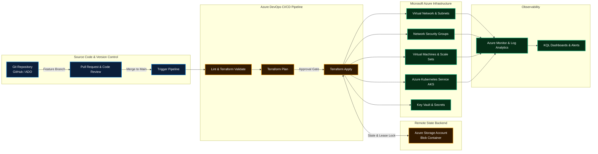

### ☁️ Senior Azure & DevOps Engineer | 17+ Years IT Experience

**Microsoft Azure · Terraform (IaC) · Azure DevOps (ADO) · CI/CD Pipelines · Git & GitHub**

---

## 👋 About Me

I am a **Senior Azure & DevOps Engineer** with **17+ years of IT experience**, with a solid track record in designing, automating, and maintaining enterprise infrastructure on **Microsoft Azure**.

My core hands-on expertise spans **Terraform Infrastructure as Code (IaC)**, **Azure DevOps (ADO) multi-stage YAML pipelines**, **Git / GitHub workflows**, and **Azure cloud architecture**. I focus on building reliable, repeatable infrastructure, automating application deployments, and streamlining team delivery without overcomplicating systems.

### 💼 What I Do:
* ☁️ **Azure Cloud Infrastructure:** Provisioning and managing VNets, Subnets, Network Security Groups (NSGs), Virtual Machines, Storage Accounts, Key Vaults, and Azure Kubernetes Service (AKS).
* 🏗️ **Terraform Automation:** Writing production-ready, reusable Terraform modules using `for_each`, maps, `dynamic` blocks, variables validation, and remote state backends with Azure Blob Storage lease locks.
* 🔄 **CI/CD with Azure DevOps & GitHub:** Designing multi-stage YAML pipelines for continuous integration and deployment, managing self-hosted and Microsoft-hosted build agents, service connections, and approval gates.
* 🔒 **Security & Secrets Management:** Storing and retrieving credentials, certificates, and keys securely using Azure Key Vault, Managed Identities, and RBAC roles.
* 📊 **Monitoring & Operations:** Writing practical KQL queries in Azure Log Analytics to track VM performance, heartbeats, storage usage, and operational alerts.
* 🛠️ **Scripting & Automation:** Writing PowerShell and Bash scripts for routine operational tasks, inventory reports, and cost-saving cleanup of orphaned resources.

---

## 🧭 Real-World DevOps & Azure Architecture Flow

---

## 🧰 Technical Skills

 

| Category | Technologies & Tools |
|---|---|
| ☁️ **Cloud Platform** | Microsoft Azure (VNets, Subnets, NSGs, Route Tables, VMs, Storage Accounts, Key Vault, AKS, Azure Bastion, Private Endpoints) |
| 🏗️ **Infrastructure as Code** | Terraform (`for_each`, maps, `dynamic` blocks, module development, state migration, backend storage locking) |
| 🔄 **CI / CD Tools** | Azure DevOps (ADO Pipelines, Multi-Stage YAML, Releases, Environments, Service Connections), GitHub Actions |
| 🌿 **Version Control** | Git, GitHub, Branching Strategies (GitFlow, Trunk-based), Pull Requests, Branch Protection Rules |
| 📜 **Scripting & Shell** | PowerShell, Azure CLI (`az cli`), Bash, Linux Administration |
| ☸️ **Containers** | Docker, Azure Kubernetes Service (AKS), Container Registry (ACR), Pods, Services, Ingress |
| 📊 **Monitoring** | Azure Monitor, Log Analytics Workspaces, KQL (Kusto Query Language), Metric Alerts |
| 🔐 **Security & Access** | Azure Active Directory / Entra ID, RBAC, Managed Identities, Azure Key Vault |

---

## 🚀 Featured Repositories

### 1. 🏗️ [`azure-enterprise-landing-zones`](https://github.com/Sujeetkumar122/azure-enterprise-landing-zones)
Modular, production-ready Terraform repository demonstrating advanced language constructs (`for_each`, maps, and `dynamic` blocks).
* **Terraform Highlights:** Uses `dynamic "security_rule"` inside NSG modules, `for_each` over subnets and route tables, and remote state backend locking in Azure Blob Storage.
* **Architecture:** Enterprise Hub-and-Spoke network topology with dedicated subnets for Firewall, Gateway, and Workload tiers.
* **CI/CD:** Automated multi-stage Azure DevOps YAML pipeline running `terraform validate`, `plan`, and `apply`.

[**View Repository →**](https://github.com/Sujeetkumar122/azure-enterprise-landing-zones)

---

### 2. 🔄 [`azure-devops-yaml-ci-cd-templates`](https://github.com/Sujeetkumar122/azure-devops-yaml-ci-cd-templates)
Production-grade Azure DevOps YAML pipeline templates designed for real-world development workflows.
* **Template Architecture:** Reusable template structure for Build, Test, Security Scan, and Multi-Environment Deployments (Dev, Stage, Prod).
* **Best Practices:** Parameterized inputs, service connection integrations, artifact publishing, and manual approval gates before production releases.

[**View Repository →**](https://github.com/Sujeetkumar122/azure-devops-yaml-ci-cd-templates)

---

### 3. ☸️ [`azure-kubernetes-aks-terraform`](https://github.com/Sujeetkumar122/azure-kubernetes-aks-terraform)
Clean, standard Terraform module to provision and configure Azure Kubernetes Service (AKS).
* **Components:** System node pool, user node pool, Azure CNI networking, Managed Identity, and integration with Azure Monitor.
* **Practical Design:** Readable variables, outputs, and `.tfvars` examples that can be directly adapted for customer projects.

[**View Repository →**](https://github.com/Sujeetkumar122/azure-kubernetes-aks-terraform)

---

### 4. 💰 [`azure-cost-optimization-automation`](https://github.com/Sujeetkumar122/azure-cost-optimization-automation)
Practical PowerShell and Azure CLI automation scripts to identify and clean up unattached cloud resources.
* **Cost Savings:** Detects unattached Azure Managed Disks, obsolete snapshots, and unused Public IPs.
* **Automation:** Generates CSV inventory reports with estimated cost waste and includes scheduled VM auto-shutdown runbooks.

[**View Repository →**](https://github.com/Sujeetkumar122/azure-cost-optimization-automation)

---

### 5. 📊 [`azure-monitoring-log-analytics-kql`](https://github.com/Sujeetkumar122/azure-monitoring-log-analytics-kql)
Curated collection of practical KQL (Kusto Query Language) queries for day-to-day Azure cloud operations and monitoring.
* **Operational Queries:** VM Heartbeat status, CPU & memory utilization thresholds, failed user logins, storage operations, and NSG flow logs.
* **Alert Rules:** Ready-to-use queries for setting up Azure Monitor metric and log alert rules.

[**View Repository →**](https://github.com/Sujeetkumar122/azure-monitoring-log-analytics-kql)

---

## 💡 How I Approach Daily Work

- **Keep It Simple & Maintainable:** Infrastructure should be easy to read, review, and maintain by any team member.
- **Automate Repetitive Tasks:** If a task has to be performed more than twice, automate it using Terraform, PowerShell, or CI/CD pipelines.
- **Security by Default:** Never commit secrets, passwords, or tokens in Git. Always use Azure Key Vault and Managed Identities.
- **Test Before Applying:** Always review `terraform plan` outputs and test pipeline changes in non-production environments first.
- **Collaborative Engineering:** Clear pull request descriptions, meaningful commit messages, and thorough documentation.

---

## 📈 GitHub Activity

---

## 🤝 Connect With Me

I am always happy to connect with fellow DevOps engineers, cloud professionals, and tech teams.

 

