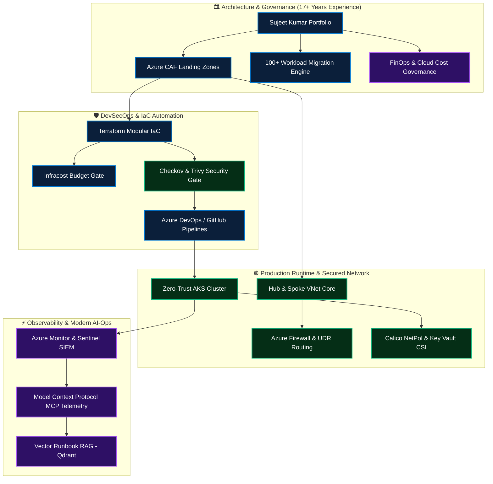
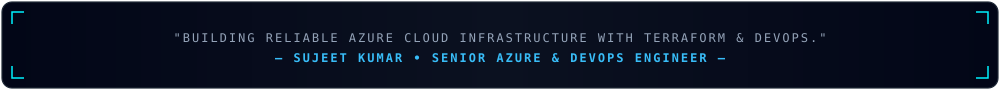

### 🔐 Senior DevSecOps Engineer & Cloud Architect | 17+ Years Experience

**Enterprise Cloud Infrastructure · Zero-Trust Security · GitOps Automation · Autonomous SRE**

---

## 👋 About Me

I am a **Senior DevSecOps Engineer & Cloud Solutions Architect** with **17+ years of experience** specializing in production-grade Microsoft Azure infrastructure, multi-cloud landing zones, shift-left pipeline security, and modern **Agentic AI systems (Model Context Protocol, RAG, and autonomous SRE operations)**.

My architectural background focuses on **governing and migrating 100+ mission-critical workloads** to the cloud with zero downtime, enforcing zero-trust infrastructure as code (Terraform), and accelerating engineering delivery cycles while maintaining 100% CIS compliance.

* ☁️ **Cloud & Scale:** Designing enterprise Hub-and-Spoke topologies, Azure Cloud Adoption Framework (CAF) landing zones, and production Kubernetes platforms (AKS).
* 🛡️ **DevSecOps & Supply Chain:** Baking automated security gates (Checkov, Trivy, TruffleHog, GitLeaks, OPA Gatekeeper) into Azure DevOps and GitHub Actions CI/CD pipelines.
* 🚚 **100+ Application Migration:** Orchestrating end-to-end cloud migrations using the 6R framework, automated discovery, wave planning, and zero-downtime cutover.
* 💰 **FinOps & Cost Governance:** Cutting over **$400K+ in annual cloud OPEX** through automated resource rightsizing, orphan storage cleanup, and predictive Infracost CI/CD gating.
* 🤖 **Modern Edge (AI-Ops):** Leveraging **Model Context Protocol (MCP)** and intelligent SRE tooling for automated log triage, root cause analysis (RCA), and runbook assistance.

---

## 🧭 Portfolio Delivery Map

---

## 🧰 Technology Stack

 

| Domain | Skills, Frameworks & Enterprise Tooling |
|---|---|
| ☁️ **Cloud & Architecture** | Microsoft Azure, AWS, Hub-and-Spoke VNets, ExpressRoute, Azure Firewall Premium, Private Endpoints, Azure Landing Zones (CAF), Azure Site Recovery (ASR) |
| 🏗️ **Infrastructure as Code** | Terraform Enterprise, Terragrunt, modular design (`for_each` + `map`), remote state locking in Azure Blob Storage, drift detection |
| 🔄 **CI/CD & Automation** | GitHub Actions, Azure DevOps Pipelines, multi-stage YAML, reusable templates, trunk-based branching, blue/green canary deployments |
| 🔐 **DevSecOps & Supply Chain** | Shift-Left security, Checkov (CIS Benchmarks), Trivy, TruffleHog, GitLeaks, SonarQube, OPA Gatekeeper, HashiCorp Vault, Entra ID PIM |
| ☸️ **Containers & Kubernetes** | Azure Kubernetes Service (AKS), Docker, Helm 3, Calico Network Policies, AGIC Ingress, Key Vault Secrets Store CSI Driver, PV/PVC |
| 📊 **Observability & SRE** | Azure Monitor, Log Analytics Workspaces, Application Insights, Microsoft Sentinel SIEM, KQL Dashboards, Prometheus, Grafana |
| 💰 **FinOps & Governance** | Infracost pre-merge budget gates, Azure Policy Initiatives, Rightsizing, Reserved Instances (RI), Savings Plans, Automated Start/Stop |
| 🤖 **Modern Edge: AI-Ops** | Model Context Protocol (MCP) telemetry tools, Vector Runbook RAG (Qdrant), automated log triage, and SRE co-pilots |

---

## 🏅 Industry Certifications & Credentials

- **AZ-305** — Microsoft Certified: Azure Solutions Architect Expert
- **AZ-400** — Designing and Implementing Microsoft DevOps Solutions
- **AZ-104** — Microsoft Certified: Azure Administrator Associate
- **CKA** — Certified Kubernetes Administrator *(Cloud Native Computing Foundation)*
- **HashiCorp Certified** — Terraform Associate (003)

---

## 🚀 Featured Enterprise Projects

### 1. 🔐 [`azure-enterprise-landing-zones`](https://github.com/Sujeetkumar122/azure-enterprise-landing-zones)
Production-grade Terraform framework implementing Microsoft Cloud Adoption Framework (CAF) with Hub-and-Spoke network topology, Privileged Identity Management (PIM), and Azure Policy guardrails.
* **Architecture:** Micro-segmented Management Groups (`Platform` vs `Landing Zones`), User Defined Routes (UDRs) forcing egress through Azure Firewall with stateful inspection.
* **Security Checks:** Enforces 100% compliance against CIS Microsoft Azure Benchmark v2.0 via automated Checkov and Trivy scans in Azure DevOps and GitHub Actions.

[**Explore Azure Landing Zones →**](https://github.com/Sujeetkumar122?tab=repositories) · [**Terraform Modules Spec**](https://github.com/Sujeetkumar122?tab=repositories) · [**CI/CD Pipeline**](https://github.com/Sujeetkumar122?tab=repositories)

---

### 2. ☸️ [`zero-trust-kubernetes-aks`](https://github.com/Sujeetkumar122/zero-trust-kubernetes-aks)
Hardened Multi-Tenant Azure Kubernetes Service (AKS) cluster deployment hosting production microservices with GitOps CI/CD automation.
* **Security & Mesh:** Calico default-deny network security policies, Azure Key Vault secrets injected via CSI driver, container image vulnerability scanning with Trivy.
* **Stateful Storage:** Resilient stateful workload management with Kubernetes Persistent Volumes (PV), PVCs, and automated volume snapshots.

[**Explore Kubernetes Platform →**](https://github.com/Sujeetkumar122?tab=repositories) · [**Network Policies**](https://github.com/Sujeetkumar122?tab=repositories) · [**Helm Charts**](https://github.com/Sujeetkumar122?tab=repositories)

---

### 3. 🚚 [`enterprise-100-app-migration-factory`](https://github.com/Sujeetkumar122/enterprise-100-app-migration-factory)
Comprehensive framework orchestrating the mass migration of 100+ mission-critical workloads from on-premises datacenters into Microsoft Azure.
* **Execution Governance:** Standardized Wave Migration Runbooks, Pre-migration checklists, Cutover checklists, and 30-day Hypercare frameworks.
* **Zero Downtime:** Database replication, live synchronization, automated sanity testing, and tested rollback procedures with under 15-minute maintenance windows.

[**Explore Migration Framework →**](https://github.com/Sujeetkumar122?tab=repositories) · [**Cutover Runbooks**](https://github.com/Sujeetkumar122?tab=repositories)

---

### 4. 💰 [`cloud-finops-sentinel`](https://github.com/Sujeetkumar122/cloud-finops-sentinel)
Serverless cloud financial management engine automating multi-subscription waste elimination and resource rightsizing.
* **Waste Elimination:** Automatically detects and purges unattached managed disks, obsolete VM snapshots, unassociated public IPs, and schedules non-production workloads outside business hours.
* **Cost Impact:** Saved **$400K+ in annual recurring cloud OPEX** across 100+ workloads with automated Infracost PR budget enforcement.

[**Explore FinOps Sentinel →**](https://github.com/Sujeetkumar122?tab=repositories) · [**Waste Detectors**](https://github.com/Sujeetkumar122?tab=repositories)

---

### 5. 🤖 [`intelligent-sre-mcp-copilot`](https://github.com/Sujeetkumar122/intelligent-sre-mcp-copilot)
Pragmatic AI-assisted operational co-pilot bridging LLMs with real-time cloud telemetry using Anthropic's **Model Context Protocol (MCP)**.
* **Autonomous SRE Assist:** Read-only MCP server safely surfacing Azure Resource Graph queries, Log Analytics telemetry, and vector-indexed SOP runbooks (Qdrant).
* **Impact:** Reduced Mean Time to Acknowledge & Diagnose (MTTA) by **40%** without granting write permissions to the AI agent.

[**Explore SRE Copilot →**](https://github.com/Sujeetkumar122?tab=repositories) · [**MCP Server Code**](https://github.com/Sujeetkumar122?tab=repositories)

---

## 🔒 How I Approach DevSecOps

- **Shift-Left Security:** Embed security checks directly into developer workflows (Git pre-commit hooks, SAST, SCA, and IaC scanning).
- **Zero-Trust Identity:** Eliminate permanent elevated privileges using Microsoft Entra ID Privileged Identity Management (PIM) with Just-In-Time access.
- **Immutable Infrastructure as Code:** Enforce version-controlled, modular Terraform modules with remote state lease locking in Azure Blob Storage.
- **Predictive FinOps Gates:** Integrate Infracost directly into pull requests to make cloud expenditure transparent and accountable before merge.
- **High Availability & Disaster Recovery:** Design multi-region failover (LRS/ZRS/GRS, VMSS) ensuring **RTO < 15 minutes** and **RPO < 5 minutes**.

---

## 🎯 Current Focus

- Expanding **Model Context Protocol (MCP)** tooling for live infrastructure diagnostics and automated SRE telemetry.
- Hardening **Zero-Trust Kubernetes security** using Calico Network Policies, CSI Secret Drivers, and Entra ID workload identity.
- Refining enterprise **Azure Cloud Adoption Framework (CAF)** landing zones with automated drift detection.
- Optimizing enterprise **Azure Monitor Agent (AMA)** Data Collection Rules to filter telemetry costs at the ingestion source.

---

## 📈 Engineering Telemetry

---

## 🤝 Connect

I welcome conversations regarding Cloud Architecture, Enterprise DevSecOps transformations, Kubernetes platforms, 100+ Workload Migrations, and FinOps optimization.

 

